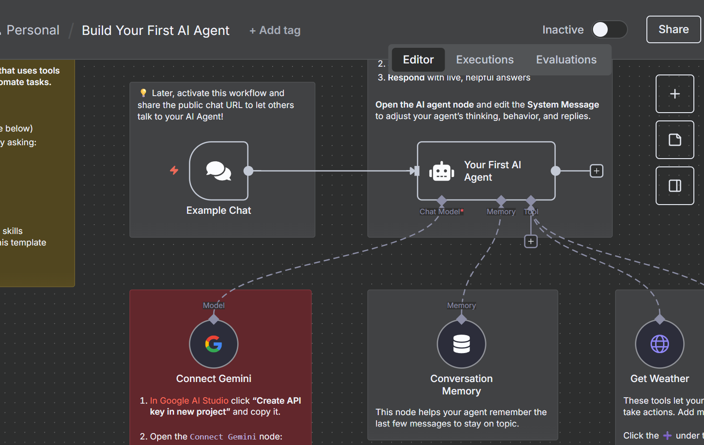
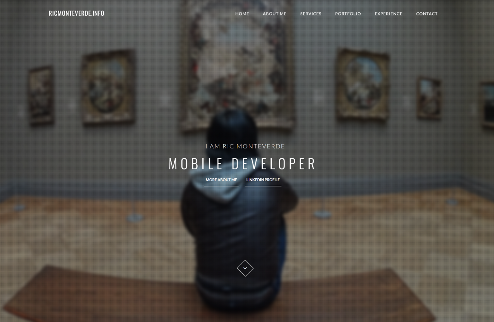

| `Current Experiment` | `Personal Website` |
|:-:|:-:|
| 

 | 

 |

- 📱&nbsp; Currently focused on integrating Agentic AI in applications and workflows
- 💬&nbsp; For professional enquiries ping-me on [LinkedIn](https://linkedin.com/in/ricmonteverde).
